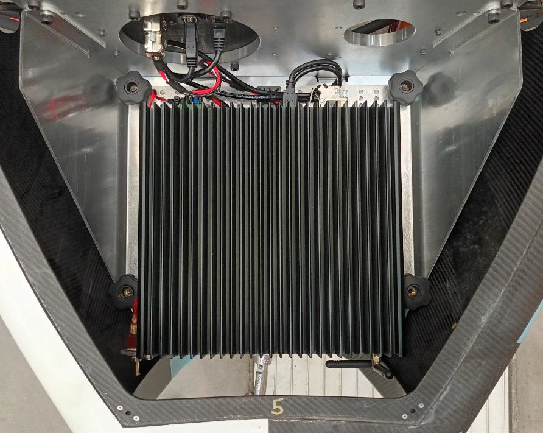
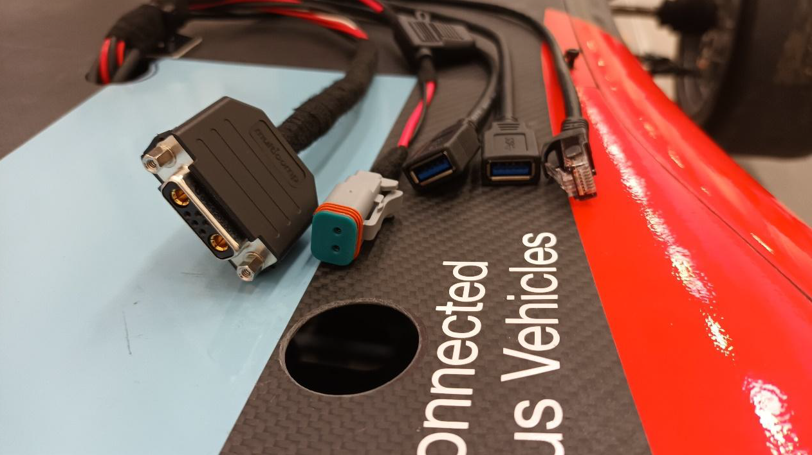
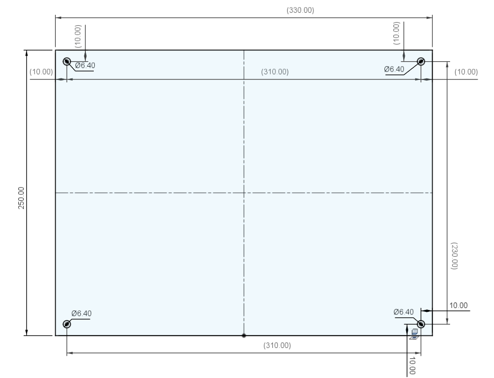
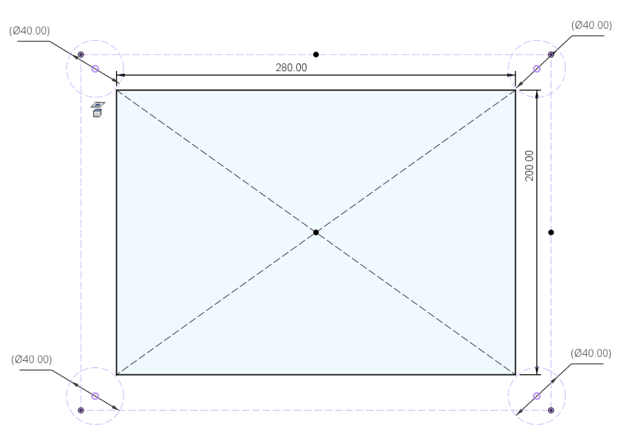
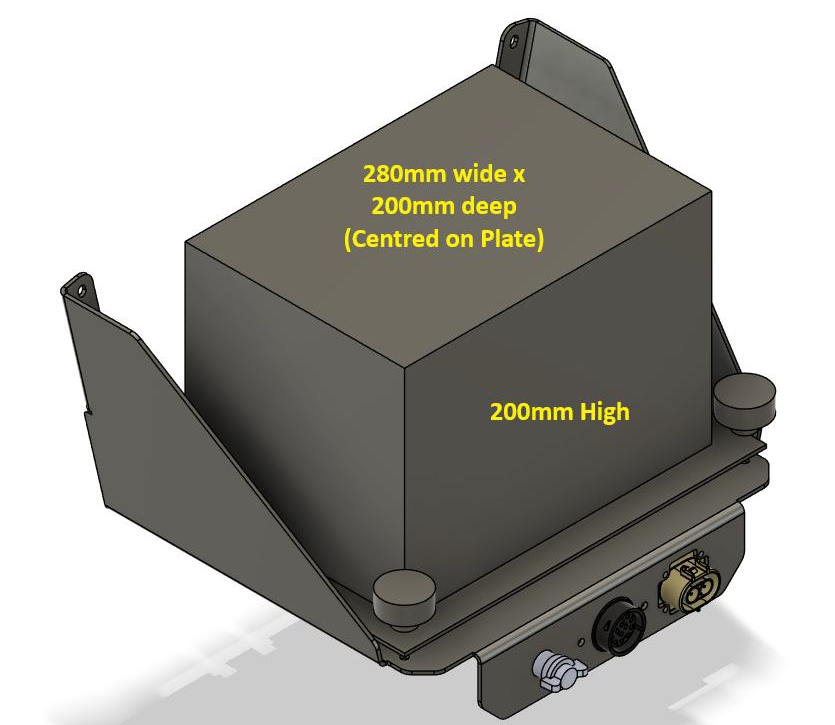
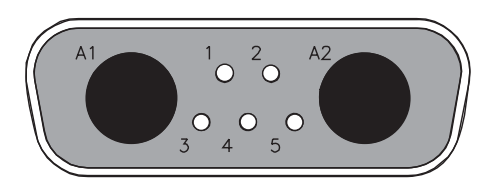

# ADS-DV Reference Compute Installation

# Introduction

From the 2025 FS-AI competition onwards, teams are allowed to bring their own compute platforms and integrate them into the ADS-DV vehicle. This allows teams to pre-test their autonomous driving software on their own compute platform and gain confidence that the software will perform as expected during the competition. Thus reducing the impact of switching over to the shared InCarPC compute platform at the event.

This document contains the design rules for team-supplied compute platforms.

**Note:**

- The 6 existing InCarPCs are all mounted onto a standard Rear Compute Mounting Plate, and will be available on all cars to allow teams to continue to use them if they choose to.

- Connections have been created to allow quick removal of the InCarPCs and installation of alternative compute platforms pre-mounted onto a compatible mounting plate at the rear of the vehicle.

- A similar connection has been added at the front of the vehicle to allow a compute platform fitted to the Standard Sensor Mounting Plate to be powered and connect to the vehicle CAN.
  - In this instance the Rear Compute Mounting need not be used.

**Figure 1 – Rear Compute Mounting – with InCar PC Installed**

**Figure 2 - Front Compute Connections**

# Rear Compute Installation Mechanical Specification

Teams wishing to fit their own compute platform at the rear of the vehicle must adhere to the following Mechanical Specification:

<table>
<tr><td>Rear Mounting Plate Dimensions</td>

<td>Teams will need to manufacture a mounting plate to the dimensions shown in Figure 3 (below). 

This mounting plate will then have the compute platform installed on it to allow quick installation and removal.
Plate Thickness: minimum 2mm / maximum 5mm.</td></tr>

<tr><td>Rear Mounting Hardware Clearance</td>

<td>The vehicle will have 4 mounting posts with 40mm OD quick-release clamping knobs. The compute platform should be installed on the mounting plate so that clearance is available for the quick release fasteners.

Mounting posts Diameter: 6 mm.
Mounting fastener clearance spacing: See Figure 4 (below)</td></tr>

<tr><td>Rear Compute Platform dimensions</td>

<td>In order to leave room for the mounting the Rear Compute maximum recommended size is shown in Figure 4 (below).

**Note: No part of the compute platform should extend above the rear vehicle bodywork panel.**
**Note: If more room is required than shown in Figure 5 for the selected compute platform, a STEP file is available for CAD use here: [LINK](/CAD/ADS-DV_Rear_Compute_Installation.stp)**
</td></tr>

<tr><td>Rear Compute Platform mass</td>

<td>Maximum mass: 8kg (including mounting plate)</td></tr>

<tr><td>Vibration Isolation</td>

<td>The mounting plate will be mounted rigidly to the vehicle chassis.

Teams should consider the need for Anti-Vibration (AV) mounts to decouple the compute platform components from the mounting plate.</td></tr></table>

**Figure 3 - Rear Compute Plate Required Dimensions**

**Figure 4 - Rear Compute Platform Required Clearance**

**Figure 5 - Rear Compute Maximum Recommended Size**

# Electrical Specification

The vehicle connection for the Rear Compute Installation and the Front Sensor Plate are the same and have the following specification:

<table><tr><td>

**Connection**</td><td>**Specification**
</td></tr>

<tr><td>

**Compute Power and CAN**</td><td>

**Connector:** Mixed Signal D-sub (2 power, 5 signal) socket.

**Socket Part Number (Vehicle):**
Harting 09 69 202 0072 (e.g. RS 693-0982) - Crimp Type
**or**
Norcomp 680M7W2203L401 (e.g. RS 174-8736) - Solder Type
 
**Plug Part Number (Compute Platform):**
Harting 09 69 212 0072 (e.g. RS 693-1026) - Crimp Type
(for Harting crimp pin info, see Table 1)
**or**
Norcomp 680M7W2103L401 (e.g. RS 174-8727) - Solder Type

**Pinout:** see Figure 6.

- **Power:**
  - Voltage: 13.7V Nominal
  - Maximum Current: 30A (protected by fuse).
  - **NOTE: The front/rear compute power and sensor plate power will be provided via the same 30A fused supply. Total combined current draw from both front and rear compute platform and sensor plate connections should not exceed 30A.**

- **CAN:**
  - This will give access to the existing vehicle Standard CAN interface with 500kbps baud rate. Teams will need to provide and integrate a CAN interface into their compute platforms.
  - **NOTE: The CAN network is fully terminated in the vehicle.
  No additional CAN termination is required in the sensor plate or compute platform.**
</td></tr>
</table>

**Figure 6 - Front View of the Compute Power & CAN connector on the Compute side**

**CHECK PIN NUMBERS ON THE CONNECTOR!!!**

**CHECK POWER POLARITY WITH A MULTIMETER BEFORE CONNECTING COMPUTE PLATFORM!!!**

<table><tr><td>

**Pin**
</td><td>

**Description**
</td></tr><tr><td>A1</td><td>+12V Power Supply (30A max).</td></tr>
<tr><td>A2</td><td>0V Power Supply.</td></tr>
<tr><td>1</td><td>CAN-H.</td></tr>
<tr><td>2</td><td>CAN-L.</td></tr>
<tr><td>3</td><td>Reserved.</td></tr>
<tr><td>4</td><td>Reserved.</td></tr>
<tr><td>5</td><td>Reserved.</td></tr>
</table>

**Table 1 - Compute Power and CAN Plug - Crimp Pin Information**

<table><tr><td>

**Pin Type**
</td><td>

**Harting Part No.**
</td><td>

**e.g. Supplier Stock Numbers**
</td></tr>

<tr><td>Power (30A Max)</td><td>09692825422</td><td>Mouser: 617-09692825422</td></tr>
<tr><td>Power (20A Max)</td><td>09692825421</td><td>Farnell: 2752369 or Mouser: 617-09692825421</td></tr>
<tr><td>Signal (Option 1)</td><td>09670008177</td><td>RS Stock No: 741-2839 or Farnell: 2752325 or Mouser: 617-09670008177</td></tr>
<tr><td>Signal (Option 2)</td><td>09670008576</td><td>RS Stock No: 755-3845 or Farnell: 2084551 or Mouser: 617-09670008576</td></tr>
</table>
